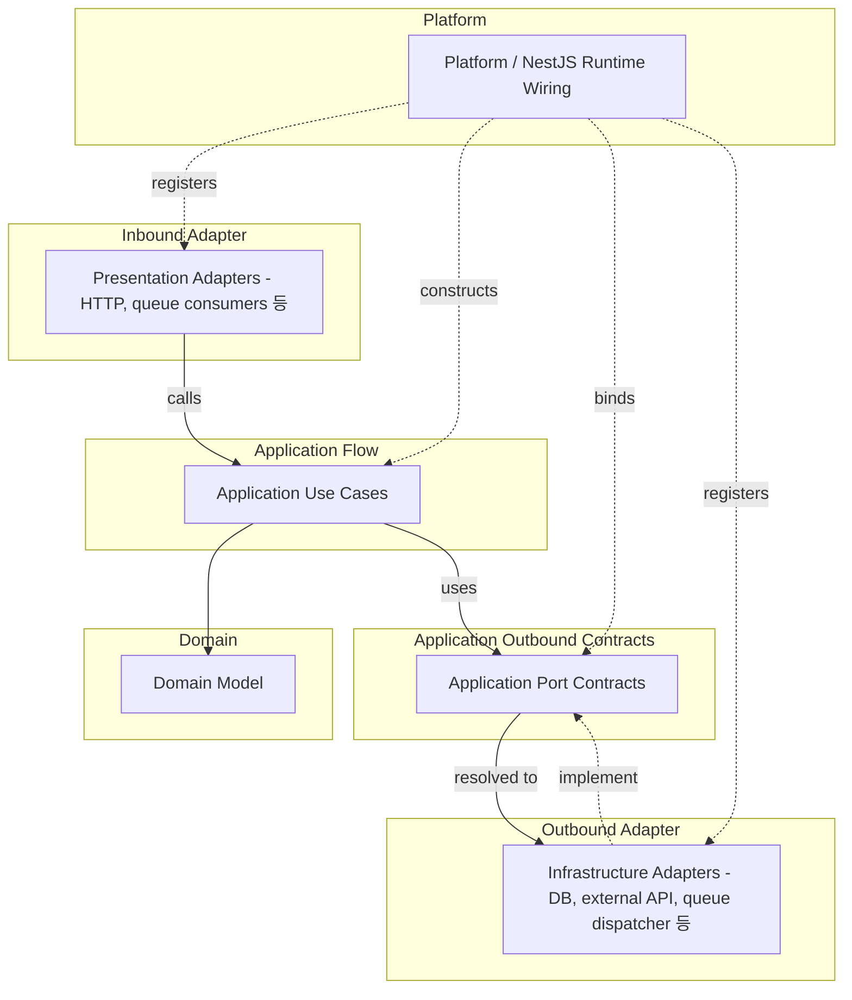

# API Runtime Wiring 컨벤션

## 적용 범위

- 객체 생성, provider 연결, port 구현체 등록, NestJS DI 사용, runtime 설정 소유권을 결정할 때 이 문서를
  사용한다.
- 한 소스 파일이 다른 소스 파일을 import할 수 있는지는
  [source dependency 컨벤션](./source-dependency.md)을 사용해 판단한다.
- Runtime wiring은 source dependency 규칙을 약화해서는 안 된다.

## Runtime Model

### Runtime Flow And Wiring Map

- 이 다이어그램은 소스 import가 아니라 runtime 흐름과 provider 연결을 보여준다.
  - 실선 화살표는 runtime 호출 또는 사용 방향을 나타낸다.
  - 점선 화살표는 provider 등록, 연결 또는 구현을 나타낸다.



## Platform

- `src/main.ts`는 얇은 프로세스 진입점으로 유지한다.
- `platform`은 애플리케이션 시작과 runtime 배선을 소유한다.
  - NestJS 루트 모듈, 시작 함수, runtime 설정 로딩, 전역 filter, interceptor, guard, pipe, 앱 수준 provider
    배선에는 `platform/nest`를 사용한다.
  - `platform`은 비즈니스 규칙을 담지 않는다.
- `platform`이 무엇에 의존할 수 있고 누가 `platform`을 import할 수 있는지는
  [source dependency 컨벤션](./source-dependency.md#source-area)에 있다.

## Environment Configuration

- env 파일, 비밀값 전달, 환경 이름으로 분기하지 않는 규칙은 [실행 환경](../../../../../docs/ko/environments.md)을 따른다.
  이 절은 그 설정값을 API 안에서 누가 소유하고 어떻게 배선하는지를 다룬다.
- 설정은 묶음마다 `registerAs`로 정의하고, 묶음의 `KEY` token으로 주입받는다. `ConfigService.get`으로 꺼내지 않는다.
  - 문자열 키로 꺼내면 오타와 타입을 컴파일러가 잡지 못하고, 모듈이 어떤 설정에 기대는지 드러나지 않는다.
  - 주입받는 쪽은 `ConfigType<typeof xxxConfig>`로 타입을 정한다.
- 묶음은 자기 factory 안에서 `process.env`를 zod schema로 검증하고 앱이 쓰는 모양으로 바꾼다.
  묶음 안의 잘못된 설정은 `safeParse`와 `z.prettifyError`로 한 번에 모두 알린다.
  - 묶음의 설정을 한 파일에서 위에서 아래로 읽을 수 있다.
  - 어댑터를 고르는 설정처럼 고른 값에 따라 필요한 설정이 달라지는 묶음도 자기 schema로 표현할 수 있다.
  - 묶음 밖의 production 코드는 `process.env`를 읽지 않는다.
- 묶음의 schema는 앱과 앱을 배포하는 쪽 사이의 계약이다.
  환경 변수마다 JSDoc으로 뜻과 형식을 적고, 비밀값이면 비밀값이라고 적는다.
  - env 파일과 Helm values를 쓰는 사람은 코드를 따라가지 않고 schema만 보고 값을 채울 수 있어야 한다.
- 묶음은 그 설정을 쓰는 경계가 소유하고, 쓰는 코드 옆에 `*.config.ts`로 둔다.
  - 앱 전체가 쓰는 묶음은 `platform`이, 한 어댑터만 쓰는 묶음은 그 어댑터 디렉터리가 소유한다.
- 묶음은 `AppModule`의 `ConfigModule.forRoot({ load })`에 등록한다.
  - 앱이 받는 설정 묶음을 한 곳에서 볼 수 있다.
- 같은 모듈을 여러 루트 모듈이 import하면, 그 모듈이 쓰는 묶음은 그 모듈이 `ConfigModule.forFeature`로 등록한다.
  예: API 서버의 `AppModule`과 마이그레이션 Job의 루트 모듈이 함께 import하는 컨텍스트 모듈
  - 루트 모듈마다 같은 묶음을 `load`에 반복해 넣으면 한 곳을 빠뜨렸을 때 그 루트에서만 주입에 실패한다.
  - 루트 모듈의 `load`에는 그 루트가 직접 쓰는 묶음만 남아, 각 진입점이 자기에게 필요한 설정만 요구한다.
  - `forFeature`는 import될 때마다 factory를 다시 실행한다.
    비밀값 파일을 읽는 묶음은 여러 경로로 import되지 않는 모듈에서 등록한다.
- Nest 모듈 밖에서 실행되는 진입점은 묶음의 factory를 직접 호출한다. 예: OTel bootstrap, 마이그레이션 스크립트
  - `registerAs`가 돌려주는 값은 그대로 호출할 수 있는 factory라서, Nest 안과 밖이 같은 검증을 거친다.
- 비밀값은 `X`나 `X_FILE` 중 하나로 받는다. `X_FILE`은 값이 든 파일의 경로이고, 둘 다 있으면 시작하지 않는다.
  비밀값인 이름은 묶음의 factory가 `withFileSecrets`에 넘겨 정한다.
  - 클러스터는 비밀값을 파일로 마운트한다. local과 test는 env 파일로 값을 넣는다.
  - 파일에서 읽은 값을 `process.env`에 다시 넣지 않는다.
    넣으면 비밀값을 환경 변수로 두지 않으려고 파일을 쓴 이유가 사라진다.
  - 둘 다 있으면 어느 값을 쓰는지 배포 설정만 보고 알 수 없다.
- 어댑터를 환경 변수로 고를 때, 어댑터 전용 환경 변수는 그 어댑터를 고른 경우에만 필수로 둔다.
  이름은 어댑터 이름으로 시작한다. 예: `KAKAO_API_KEY`
  - 항상 필수로 두면 다른 어댑터를 쓰는 환경에도 가짜 값을 넣어야 한다.
    항상 선택으로 두면 빠진 값이 시작할 때가 아니라 어댑터를 처음 쓸 때 드러난다.
  - 어댑터 전용 설정은 묶음의 결과에서 고른 어댑터의 값 안에만 두어, 그 어댑터만 받게 한다.

  ```ts
  const notificationEnvSchema = z.discriminatedUnion('NOTIFICATION_SENDER', [
    z.object({
      /** 알림을 보내지 않고 로그에만 남긴다. */
      NOTIFICATION_SENDER: z.literal('log'),
    }),
    z.object({
      /** 카카오 알림톡으로 보낸다. */
      NOTIFICATION_SENDER: z.literal('kakao'),
      /** 카카오 알림톡 API 키다. 비밀값이다. */
      KAKAO_API_KEY: z.string().min(1),
    }),
  ]);

  export const notificationConfig = registerAs('notification', () => {
    const result = notificationEnvSchema.safeParse(process.env);
    if (!result.success) {
      throw new Error(`Invalid notification configuration.\n${z.prettifyError(result.error)}`);
    }
    const env = result.data;
    switch (env.NOTIFICATION_SENDER) {
      case 'log':
        return { sender: 'log' as const };
      case 'kakao':
        return { sender: 'kakao' as const, kakao: { apiKey: env.KAKAO_API_KEY } };
    }
  });

  // 모듈의 provider
  {
    provide: NOTIFICATION_SENDER,
    useFactory: (config: ConfigType<typeof notificationConfig>) => {
      switch (config.sender) {
        case 'log':
          return new LogNotificationSender();
        case 'kakao':
          return new KakaoNotificationSender(config.kakao);
      }
    },
    inject: [notificationConfig.KEY],
  }
  ```

- 묶음의 테스트는 `vi.stubEnv`로 환경 변수를 바꾸고 factory를 호출한다.

## NestJS DI

### DI 경계

- NestJS DI는 `platform/nest`, presentation 어댑터, infrastructure 어댑터, application 유스 케이스와 서비스의
  runtime 배선에 사용한다. `core`, domain, kernel은 framework와 무관하게 유지한다.
- Application 코드에서 DI는 생성자 주입을 설명하는 좁은 metadata(`@Injectable()`, `@Inject()`, provider token)까지만
  사용한다.
  - 유스 케이스는 명시적인 의존성만으로 생성되는 일반 TypeScript 클래스로 유지한다.
  - 유스 케이스 동작이 request 객체, module reference, container lookup, lifecycle callback에 의존하기 시작하면
    이미 그 선을 넘은 것이다.
- Provider 등록과 모듈 조립은 `platform/nest` 또는 바운디드 컨텍스트 루트 모듈에 둔다.
  - 바운디드 컨텍스트 루트 모듈은 해당 컨텍스트의 application, presentation, infrastructure provider를
    조립할 수 있다.
  - 유스 케이스 폴더마다 모듈을 만들기보다 바운디드 컨텍스트 또는 runtime 경계 단위로 조립한다.

### 동적 모듈 조립

- `forRoot()`/`forFeature()` 같은 `DynamicModule` factory는 호출할 때마다 새 module instance를 반환한다.
  - NestJS는 import path가 다른 동적 모듈을 중복 제거하지 않는다.
  - 여러 import path가 같은 `forRoot()`에 도달하면 각 path가 모듈을 인스턴스화한다.
  - 해당 모듈의 listener, consumer, controller도 함께 중복 등록된다.
- `forRoot()`와 `forFeature()`를 모두 제공하는 바운디드 컨텍스트 루트 모듈은 책임을 분리해야 한다.
  - Event listener, queue consumer, scheduler, controller는 `forRoot()`에만 둔다.
  - `forFeature()`에는 여러 번 생성해도 안전한 stateless provider만 둔다.
  - Token과 repository가 stateless provider의 예다.
- Provider의 `forFeature()` 포함 여부는 현재 consumer가 아니라 stateless 여부로 결정한다.
  - 현재 유일한 consumer가 사용하지 않는다는 이유로 stateless provider를 제거하지 않는다.
- Consumer마다 서로 겹치지 않는 provider 일부가 필요하다면 호출 지점에서 provider를 선택하게 한다.
  - 예: `forFeature(tokens)`.
  - 현재 consumer에 맞춰 공통 export 목록을 계속 조정하지 않는다.
- 컨텍스트의 `forRoot()`는 조립을 소유하는 모듈에서 한 번만 import한다.
  - Provider만 필요한 다른 모듈은 `forRoot()`가 아니라 `forFeature()`를 import해야 한다.

### 어댑터 생성

- 어댑터를 조립하는 모듈이 생성 책임을 소유한다.
  - 어댑터는 설정 묶음이나 묶음으로 만든 options 객체를 생성자로 받는다.
  - 어댑터 클래스에 `ConfigService`를 주입하지 않고, `process.env`를 읽지 않는다.
- 조정 가능한 설정을 나타내는 생성자 매개변수에는 기본값을 두어서는 안 된다.
  - Provider를 조립하는 모듈이 하드코딩된 상수를 포함한 구체적인 값을 소유한다.
  - 조립하는 모듈이 `useFactory` 또는 일반 생성자 호출을 통해 값을 명시적으로 전달한다.

### Factory Provider 생명주기

- `useFactory`로 생성하는 어댑터에는 `@Injectable()`이 필요하지 않다.
  - NestJS는 factory가 만든 instance에도 `OnModuleDestroy` 같은 lifecycle hook을 호출한다.
- 같은 모듈 안에서 `useFactory` 결과를 다른 `useFactory`로 전달하기 위한 DI token은 모듈 내부에 둔다.
  - 다른 모듈이 같은 값을 실제로 주입받아야 할 때만 token을 export한다.
- 어댑터 설정 parsing과 어댑터 생성은 하나의 `useFactory`에서 처리할 수 있다.
- Container가 어댑터 instance를 별도로 추적해야 할 때만 설정 parsing과 생성을 다른 provider로 나눈다.
  - 어댑터가 lifecycle hook을 구현하지만 공개 token은 파생된 값만 제공하는 경우가 이에 해당한다.
  - 어댑터 instance provider가 없으면 NestJS가 해당 instance의 lifecycle hook을 호출할 수 없다.

## Port Binding

- Port는 application이 소유하는 경계 계약이며 모든 interface, error type, DTO, mapper 또는 공유 계약을
  의미하지 않는다.
- 계약 파일과 타입 이름은 [infrastructure 컨벤션](./infrastructure.md)을 따른다.
- Runtime 배선은 소스 의존성을 뒤집지 않고 외부 구현체를 내부 port에 연결할 수 있다.
  - Infrastructure 어댑터는 application port를 구현할 수 있다.
  - `platform` 또는 바운디드 컨텍스트 배선이 각 port의 구현체를 등록한다.
- Runtime 배선을 이유로 domain 또는 application core에 금지된 import를 추가하면 안 된다.

## Non-Port Contracts

- 모든 경계 타입을 port로 분류하지 않는다.
  - Presentation DTO, mapper, failure response는 protocol adapter 계약이다.
  - Infrastructure exception과 persistence mapper는 어댑터 관심사다.
- Application core가 외부 레이어 계약을 사용해야 한다면 계약을 안쪽으로 옮긴다.
  - Application port 또는 application-kernel 계약으로 모델링한다.
