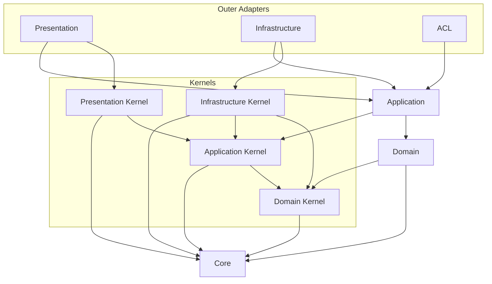

# API Source Dependency 컨벤션

## 의존 방향
- 의존성은 바깥 레이어에서 안쪽 레이어로만 향함. 화살표는 "출발지가 도착지를 import할 수 있음"을 뜻함
- 개별 import 규칙은 `apps/api/dependency-cruiser/rules/`가 강제함. 이 문서는 규칙이 왜 있는지만 씀

- `acl`은 다른 컨텍스트의 `index.ts`에도 의존함. 그림은 한 컨텍스트 안만 그림

## Source Area

| 영역 | 책임 |
|---|---|
| `core` | 레이어, framework, 컨텍스트, 비즈니스 용어가 없는 순수 primitive |
| `<context>/domain` | 비즈니스 규칙과 도메인 모델 |
| `<context>/application` | use case와 application port |
| `<context>/presentation` | application 호출을 시작하는 driving adapter. HTTP controller, queue consumer |
| `<context>/infrastructure` | application port를 구현하는 driven adapter. repository, queue dispatcher |
| `<context>/acl` | 다른 컨텍스트로 나가는 consumer 소유 port의 구현 |
| `kernels/*` | 여러 컨텍스트가 공유하는 계약과 구현 |
| `platform` | process 시작과 runtime 배선 |

- presentation과 infrastructure는 기술이 아니라 방향으로 나눔. 같은 기술(예: BullMQ)이 한 기능의 양쪽에 나타날 수 있음
- domain과 application은 DB, HTTP, SDK, framework runtime에 의존하지 않음. I/O와 부수효과가 없어야 규칙만 따로 테스트할 수 있음
- application이 framework 기능을 쓸 때는 자기가 소유한 계약을 거침. 예: integration event 발행은 `IntegrationEventDispatcher` 계약을 쓰고, event emitter를 쥔 adapter는 `platform`에 둠
- application 계약은 패턴이 아니라 제공하는 기능으로 이름 지음. `Port` 접미사와 `.port.ts`를 쓰지 않음. 예: `source.lookup.ts`의 `SourceLookup`

## 외부 모듈
- 도메인은 결정적이고 부수효과가 없는 계산만 외부 모듈로 구현할 수 있음. 예: 해시
  - 도메인을 떼어 두는 이유는 런타임 교체가 아니라 테스트 가능성과 결정성임. 순수 계산은 둘 다 깨지 않음
  - 결정적이지 않은 UUIDv7 생성은 예외임. 모든 aggregate가 생성 시점에 식별자를 만들어야 함
- `node:fs`, `process.env`, DB, HTTP처럼 I/O, 환경, process에 닿는 모듈은 도메인 쪽에서 쓰지 않음
- 외부 모듈은 `core`의 얇은 래퍼에서만 import하고 도메인은 그 래퍼를 씀
  - 허용 범위가 래퍼 파일로 모여서 도메인의 의존 규칙을 넓히지 않아도 됨
  - 인코딩과 출력 형식을 한 곳에서 고정함
- 허용 목록에 모듈을 더할 때는 위 기준을 리뷰에서 확인함

## Import Path
- path alias는 `apps/api/tsconfig.json` 한 곳에만 선언함. 다른 도구는 그 파일을 읽음
- alias는 경로를 줄이는 수단이 아니라 경계의 이름임. `@core/*`, `@kernels/*`, `@contexts/*`, `@platform/*`만 두고 `@/*` 같은 넓은 alias는 두지 않음

## Public Surface
- `index.ts`는 일부러 공개하는 계약의 창구임. 내부 export를 모두 다시 내보내지 않음
- 다른 영역이 실제로 import해야 하는 계약만 내보냄. 구현, 헬퍼, adapter 세부, 테스트 fixture는 내보내지 않음

## Kernel
- kernel은 여러 컨텍스트가 실제로 공유하는 안정적인 것만 담음. 일반 유틸리티 모음이 아님
- 여러 컨텍스트가 adapter의 동작과 lifecycle을 모두 재사용할 때만 `kernels/infrastructure`로 올림. 아니면 소유 컨텍스트에 둠
- 공유 개념이 불안정하거나 한 컨텍스트에만 해당하면 `kernels/domain`으로 옮기지 않고 중복을 허용함
- feature event, payload, 정책을 여러 컨텍스트가 import하게 하려고 kernel로 옮기지 않음. kernel은 컨텍스트 통합 창구가 아님
- `kernels/application`과 `kernels/domain`의 계약은 기술 중립임. DB row, query builder, queue job, HTTP 객체를 노출하지 않음
