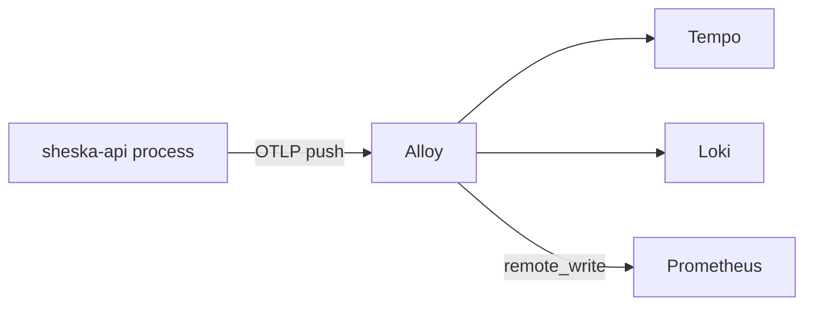

# API 옵저버빌리티 컨벤션

## 전송
- API는 trace, log, metric을 모두 OTLP로 공용 Alloy에 push함

- metric도 수집기가 가져가게 노출하지 않고 push함
  - 클러스터의 수집기는 VPN 너머의 로컬 개발 프로세스에 닿지 못함
  - 전송 방식이 하나면 운영과 개발의 코드 경로가 같음
- 로컬 전용 pull 경로는 두지 않음

## 소유 경계
- 이 저장소는 애플리케이션 계측, OTel 설정 파싱, 리소스 속성을 소유함
- `hash-infra` 저장소는 Alloy, telemetry backend, dashboard, endpoint 가용성을 소유함
- 리소스 속성을 더해도 Loki나 Prometheus의 label이 되지 않음. label 승격은 `hash-infra`의 Alloy 설정을 바꿔야 함
- metric의 리소스 속성을 label로 일괄 승격하지 않음
  - `process.pid`처럼 카디널리티가 높은 속성도 승격되어, 재시작할 때마다 Prometheus 시계열이 늘어남

## 리소스 속성
- service name은 코드에 둠. 배포마다 바뀌지 않는 애플리케이션 식별자임
- 실행 환경 이름(`deployment.environment.name`)은 코드가 아니라 `OTEL_RESOURCE_ATTRIBUTES`로 받음
  - 하나의 backend를 여러 환경이 공유함. 환경 이름이 없는 telemetry는 구분할 수 없어서, endpoint가 있는데 환경 이름이 없으면 앱이 시작하지 않음
  - `NODE_ENV`에서 가져오지 않는 이유는 [실행 환경](../../../../../docs/ko/environments.md#설정)에 있음
- 클러스터에서는 Helm이 이미지 tag를 `service.version`으로 넣음. `node dist/main`으로 실행하면 `npm_package_version`이 없음
- endpoint가 없으면 SDK를 시작하지 않음. test 환경은 이렇게 telemetry를 보내지 않음

## 시작 순서
- OTel bootstrap은 `main.ts`의 첫 import여야 함
  - auto-instrumentation은 `http`, `pg`, `ioredis` 같은 모듈을 로드할 때 patch함. 먼저 로드된 모듈은 계측되지 않음
- bootstrap을 NestJS provider나 module로 만들지 않음. NestJS가 시작하기 전에 실행되어야 함

## 로그 통합
- trace 상관관계를 위한 pino `mixin`을 추가하지 않음. `@opentelemetry/instrumentation-pino`가 `trace_id`와 `span_id`를 이미 넣음
- OTel log 전송을 위한 두 번째 pino transport를 추가하지 않음. 같은 instrumentation이 이미 log를 OTel로 보냄
