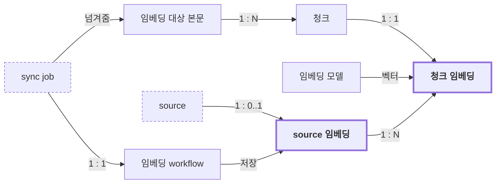

# Ingestion 도메인

## 개요

`ingestion`은 sync job으로 받은 임베딩 대상 본문을 청크로 나누고 임베딩해 source 임베딩으로 저장하는 방법을 정한다.
언제 임베딩을 다시 만들지와 sync job의 상태는 `library`가 정한다.

## 개념 구조

- 임베딩 workflow 하나가 sync job 하나를 처리하고, 결과를 source 임베딩 하나로 저장한 뒤 `library`에 통지한다.

## 청크 규칙 (chunk)

무엇을 임베딩하고 어떤 크기의 청크로 나누는지 정한다.

### 임베딩 대상
- 임베딩 대상 본문은 source의 본문이어야 한다. <!-- nocap: ingestion-chunk-1 -->
  - 예: 제목과 frontmatter는 임베딩하지 않는다.

### 청크 길이
- 청크는 상한 길이를 넘을 수 없다. <!-- nocap: ingestion-chunk-2 -->
  - 이유: 청크가 길면 벡터 하나에 여러 주제가 섞여 검색 정확도가 떨어진다.

### 청크 겹침
- 인접한 청크는 경계 부분을 겹쳐야 한다. <!-- nocap: ingestion-chunk-3 -->
  - 이유: 경계에서 잘린 문장이 앞뒤 문맥을 잃지 않게 한다.

## 임베딩 모델 규칙 (embeddingModel)

어떤 임베딩 모델로 벡터를 만드는지 정한다.

### 한 시점의 모델
- 한 시점에 허용하는 임베딩 모델은 둘 이상일 수 없다. <!-- nocap: ingestion-embeddingModel-1 -->
  - 이유: 모델이 다르면 벡터를 서로 비교할 수 없다.

### source 임베딩 안의 모델
- 한 source 임베딩 안의 청크 임베딩은 모두 같은 임베딩 모델로 만들어야 한다. <!-- nocap: ingestion-embeddingModel-2 -->

## Source 임베딩 규칙 (sourceEmbedding)

source 임베딩을 언제 저장하고 교체하고 지우는지 정한다.

### 통째로 교체
- 새 source 임베딩은 이전 source 임베딩을 통째로 교체해야 한다. <!-- nocap: ingestion-sourceEmbedding-1 -->
  - 이유: 검색이 서로 다른 버전의 청크를 섞어 보지 않게 한다.

### 늦게 끝난 이전 결과
- 임베딩 workflow 결과는 저장된 source 임베딩의 sync job보다 나중에 만들어진 sync job의 결과일 때만 저장할 수 있다. <!-- nocap: ingestion-sourceEmbedding-2 -->
  - 이유: workflow는 만들어진 순서와 다르게 끝날 수 있다. 끝난 순서대로 저장하면 이전 내용이 최신 내용을 덮어쓴다.

### 빈 본문
- 임베딩 대상 본문이 비어 있으면 임베딩 workflow는 청크 없이 정상 완료하고 이전 source 임베딩을 지워야 한다. <!-- nocap: ingestion-sourceEmbedding-3 -->
  - 이유: 실패로 처리하면 동기화 클라이언트가 끝없이 재시도하고, 이전 임베딩을 남기면 비운 문서가 이전 내용으로 검색된다.

### 빠진 청크
- 청크 임베딩이 하나라도 빠진 임베딩 workflow 결과는 저장할 수 없다. <!-- nocap: ingestion-sourceEmbedding-4 -->
  - 참고: 이때 sync job은 실패로 통지하고, 이전 source 임베딩은 그대로 남는다.

### 저장과 완료 통지
- source 임베딩 저장과 완료 통지는 함께 성공하거나 함께 실패해야 한다. <!-- nocap: ingestion-sourceEmbedding-5 -->

### 지운 source의 임베딩
- 지운 source의 source 임베딩은 지워야 한다. <!-- nocap: ingestion-sourceEmbedding-6 -->

### 지운 뒤에 끝난 workflow
- 지운 source의 임베딩 workflow 결과는 저장할 수 없다. <!-- nocap: ingestion-sourceEmbedding-7 -->

## 재시도 규칙 (retry)

임베딩이 실패했을 때 누가 다시 시도하는지 정한다.

### 실패한 sync job
- `ingestion`은 실패한 sync job을 다시 시작할 수 없다. <!-- nocap: ingestion-retry-1 -->
  - 참고: 재시도는 동기화 클라이언트가 같은 내용을 다시 보내 새 sync job으로 들어온다.
