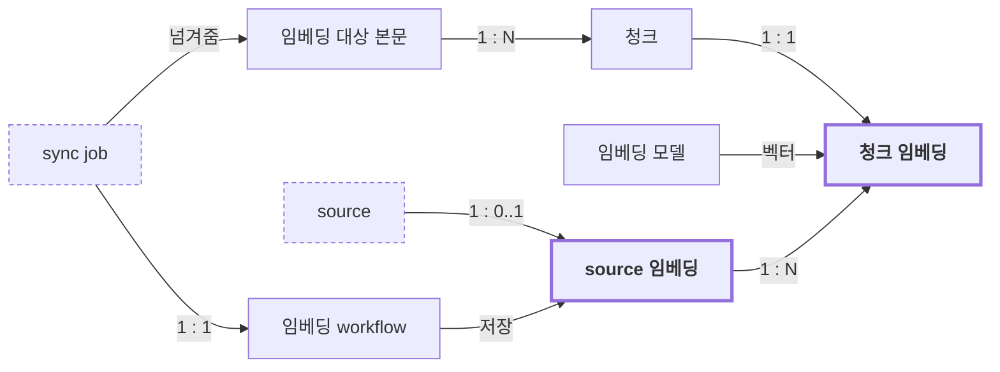

# Ingestion 도메인

## 개요

`ingestion`은 sync job으로 받은 임베딩 대상 본문을 청크로 나누고 임베딩해 source 임베딩으로 저장하는 방법을 정한다.
청크, 임베딩 모델, source 임베딩의 저장과 교체를 다룬다.
언제 임베딩을 다시 만들지와 sync job의 상태는 `library`가 정한다.

## 개념 구조

- `library`가 sync job과 함께 임베딩 대상 본문을 넘긴다. 임베딩 workflow 하나가 sync job 하나를 처리한다.
- 임베딩 workflow는 임베딩 대상 본문을 청크로 나누고, 청크마다 임베딩 모델로 청크 임베딩을 만든다.
- 임베딩 workflow는 청크 임베딩을 모아 source 임베딩 하나로 저장하고 `library`에 완료나 실패를 통지한다.

## 청크 규칙 (chunk)

무엇을 임베딩하고 어떤 크기의 청크로 나누는지 정한다.

| ID | 규칙 |
|---|---|
| [ingestion.chunk-1](#ingestionchunk-1-임베딩-대상) | 임베딩 대상 본문은 source의 본문이어야 한다. |
| [ingestion.chunk-2](#ingestionchunk-2-청크-길이) | 청크는 상한 길이를 넘을 수 없다. |
| [ingestion.chunk-3](#ingestionchunk-3-청크-겹침) | 인접한 청크는 경계 부분을 겹쳐야 한다. |

### ingestion.chunk-1 임베딩 대상

임베딩 대상 본문은 source의 본문이어야 한다.
- 예: 제목과 frontmatter는 임베딩하지 않는다.

### ingestion.chunk-2 청크 길이

청크는 상한 길이를 넘을 수 없다.
- 이유: 청크가 길면 벡터 하나에 여러 주제가 섞여 검색 정확도가 떨어진다.
- 이유: 청크가 길면 작은 임베딩 모델에서 처리 시간이 입력 길이보다 빠르게 늘어 timeout이 잦아진다.
- 참고: 상한 길이는 임베딩 모델을 보며 조정하는 값이라 API 코드가 정한다.

### ingestion.chunk-3 청크 겹침

인접한 청크는 경계 부분을 겹쳐야 한다.
- 이유: 문장이나 문단이 청크 경계에서 잘려도 앞뒤 문맥을 잃지 않게 한다.
- 참고: 겹치는 길이는 API 코드가 정한다.

## 임베딩 모델 규칙 (embeddingModel)

어떤 임베딩 모델로 벡터를 만드는지 정한다.

| ID | 규칙 |
|---|---|
| [ingestion.embeddingModel-1](#ingestionembeddingmodel-1-한-시점의-모델) | 한 시점에 허용하는 임베딩 모델은 둘 이상일 수 없다. |
| [ingestion.embeddingModel-2](#ingestionembeddingmodel-2-source-임베딩-안의-모델) | 한 source 임베딩 안의 청크 임베딩은 모두 같은 임베딩 모델로 만들어야 한다. |

### ingestion.embeddingModel-1 한 시점의 모델

한 시점에 허용하는 임베딩 모델은 둘 이상일 수 없다.
- 이유: 모델이 다르면 벡터를 서로 비교할 수 없다. 모델이 섞이면 의미 검색 순위가 무의미해진다.

### ingestion.embeddingModel-2 source 임베딩 안의 모델

한 source 임베딩 안의 청크 임베딩은 모두 같은 임베딩 모델로 만들어야 한다.
- 참고: 다른 모델의 결과가 섞인 임베딩 workflow 결과는 저장하지 않고 실패로 처리한다.

## Source 임베딩 규칙 (sourceEmbedding)

source 임베딩을 언제 저장하고 교체하고 지우는지 정한다.

| ID | 규칙 |
|---|---|
| [ingestion.sourceEmbedding-1](#ingestionsourceembedding-1-통째로-교체) | 새 source 임베딩은 이전 source 임베딩을 통째로 교체해야 한다. |
| [ingestion.sourceEmbedding-2](#ingestionsourceembedding-2-늦게-끝난-이전-결과) | 임베딩 workflow 결과는 저장된 source 임베딩의 sync job보다 나중에 만들어진 sync job의 결과일 때만 저장할 수 있다. |
| [ingestion.sourceEmbedding-3](#ingestionsourceembedding-3-빈-본문) | 임베딩 대상 본문이 비어 있으면 임베딩 workflow는 청크 없이 정상 완료하고 이전 source 임베딩을 지워야 한다. |
| [ingestion.sourceEmbedding-4](#ingestionsourceembedding-4-빠진-청크) | 청크 임베딩이 하나라도 빠진 임베딩 workflow 결과는 저장할 수 없다. |
| [ingestion.sourceEmbedding-5](#ingestionsourceembedding-5-저장과-완료-통지) | source 임베딩 저장과 완료 통지는 함께 성공하거나 함께 실패해야 한다. |
| [ingestion.sourceEmbedding-6](#ingestionsourceembedding-6-지운-source의-임베딩) | 지운 source의 source 임베딩은 지워야 한다. |
| [ingestion.sourceEmbedding-7](#ingestionsourceembedding-7-지운-뒤에-끝난-workflow) | 지운 source의 임베딩 workflow 결과는 저장할 수 없다. |

### ingestion.sourceEmbedding-1 통째로 교체

새 source 임베딩은 이전 source 임베딩을 통째로 교체해야 한다.
- 예: source 하나에 source 임베딩은 하나뿐이고, 이전 버전은 보관하지 않는다.
- 이유: 검색이 서로 다른 버전의 청크를 섞어 보지 않게 한다.

### ingestion.sourceEmbedding-2 늦게 끝난 이전 결과

임베딩 workflow 결과는 저장된 source 임베딩의 sync job보다 나중에 만들어진 sync job의 결과일 때만 저장할 수 있다.
- 예: 내용이 빠르게 두 번 바뀌면 두 임베딩 workflow가 함께 돌고, 끝나는 순서는 만들어진 순서와 다를 수 있다.
- 이유: 끝난 순서대로 저장하면 이전 내용의 임베딩이 최신 내용의 임베딩을 덮어쓴다.
- 참고: 이전 임베딩 workflow를 취소하는 것은 비용을 줄이는 최적화일 뿐 이 규칙을 대신하지 않는다.

### ingestion.sourceEmbedding-3 빈 본문

임베딩 대상 본문이 비어 있으면 임베딩 workflow는 청크 없이 정상 완료하고 이전 source 임베딩을 지워야 한다.
- 이유: 내용이 없는 문서에는 검색할 내용이 없다. 실패로 처리하면 동기화 클라이언트가 끝없이 재시도한다.
- 이유: 이전 source 임베딩을 남기면 본문을 비운 문서가 이전 내용으로 검색된다.

### ingestion.sourceEmbedding-4 빠진 청크

청크 임베딩이 하나라도 빠진 임베딩 workflow 결과는 저장할 수 없다.
- 이유: 일부만 교체된 source 임베딩이 생긴다.
- 참고: 이때 sync job은 실패로 통지하고, 이전 source 임베딩은 그대로 남는다.

### ingestion.sourceEmbedding-5 저장과 완료 통지

source 임베딩 저장과 완료 통지는 함께 성공하거나 함께 실패해야 한다.
- 이유: 저장했는데 `library`가 모르거나, `library`는 완료로 아는데 저장되지 않은 상태를 만들지 않는다.

### ingestion.sourceEmbedding-6 지운 source의 임베딩

지운 source의 source 임베딩은 지워야 한다.
- 이유: 남겨 두면 지운 노트가 의미 검색과 RAG에 계속 쓰인다.

### ingestion.sourceEmbedding-7 지운 뒤에 끝난 workflow

지운 source의 임베딩 workflow 결과는 저장할 수 없다.
- 이유: 늦게 끝난 결과를 저장하면 지운 source의 임베딩이 되살아난다.

## 재시도 규칙 (retry)

임베딩이 실패했을 때 누가 다시 시도하는지 정한다.

| ID | 규칙 |
|---|---|
| [ingestion.retry-1](#ingestionretry-1-실패한-sync-job) | `ingestion`은 실패한 sync job을 다시 시작할 수 없다. |

### ingestion.retry-1 실패한 sync job

`ingestion`은 실패한 sync job을 다시 시작할 수 없다.
- 참고: 재시도는 동기화 클라이언트가 같은 내용을 다시 보내 새 sync job으로 들어온다(`library.sync-9`).
