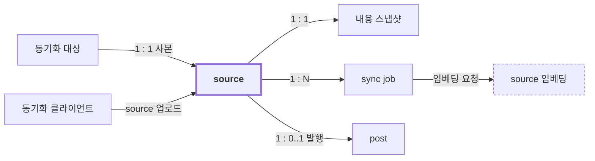
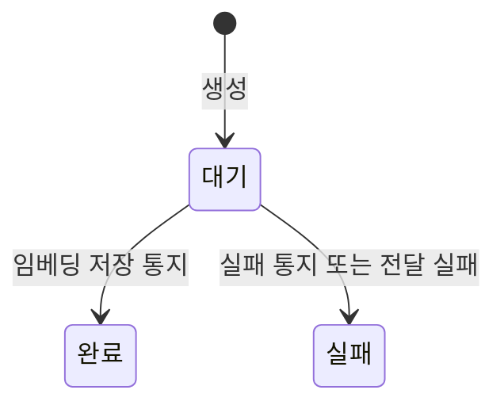

# Library 도메인

## 개요
- `library`는 어떤 vault 파일을 source로 받아 두고, 그 source를 post로 어떻게 보여 주는지 정함
- 청크를 나누고 임베딩을 만드는 일은 `ingestion`이 정함

## 개념 구조

- vault가 원본이고 source는 동기화 대상 하나의 사본임
- post는 source와 따로 있는 문서가 아니라 발행한 source임

## 생애
- sync job의 상태임. 상태 전이는 제한하지 않음(`library-syncJob-2`)

## Source 규칙 (source)
- 어떤 vault 파일이 source가 되고, source가 무엇으로 식별되고 언제 지워지는지 정함

### 원본은 vault
- source 내용은 동기화로만 바꿀 수 있음 <!-- nocap: library-source-1 -->
  - 이유: 두 곳에서 편집하면 어느 쪽이 맞는지 정할 수 없음

### 경로 하나에 source 하나
- `externalSourceId` 하나에 source는 둘 이상일 수 없음 <!-- nocap: library-source-2 -->
  - 이유: source 식별자가 유지되어야 post의 URL이 바뀌지 않음

### source 제목
- source 제목은 frontmatter `title`이 비어 있지 않은 문자열이면 그 값이어야 하고, 아니면 `externalSourceId`여야 함 <!-- nocap: library-source-3 -->
  - 예: `title: ""`, `title: 3`, `title`이 없는 경우는 `externalSourceId`임

### 틀린 frontmatter
- frontmatter 형식이 틀린 파일은 source로 받을 수 없음 <!-- nocap: library-source-4 -->
  - 예: 닫는 구분선이 없는 경우, YAML 문법이 틀린 경우, 최상위가 mapping이 아닌 경우
  - 이유: 작성자가 오류를 모른 채 깨진 문서가 발행됨

### Obsidian이 만드는 frontmatter
- 파일 맨 앞의 BOM, `---` 뒤의 공백, 빈 frontmatter는 정상 frontmatter로 읽어야 함 <!-- nocap: library-source-5 -->

### 동기화 대상
- vault 파일은 frontmatter `sheska`가 YAML boolean `true`일 때만 동기화 대상이 될 수 있음 <!-- nocap: library-source-6 -->
  - 예: `sheska: "true"`, `sheska: yes`, `sheska: 1`, `sheska`가 없는 경우는 동기화 대상이 아님
  - 이유: 값이 애매한 파일까지 올리면 소유자가 의도하지 않은 노트가 검색과 RAG에 쓰임

### source를 지우는 조건
- source는 그 vault 파일의 frontmatter `sheska`가 YAML boolean `false`일 때만 지울 수 있고, 그때는 지워야 함 <!-- nocap: library-source-7 -->
  - 예: `sheska`를 지우거나, 파일을 지우거나 옮기거나, frontmatter를 읽을 수 없게 되어도 source는 지우지 않음
  - 이유: 실수일 수 있는 변화로 post와 조회수를 잃게 하지 않음

### source와 함께 지우는 것
- source를 지우면 그 source의 sync job과 post도 함께 지워야 함 <!-- nocap: library-source-8 -->

## 동기화 규칙 (sync)
- vault 파일을 언제 보내고, source 업로드를 받으면 무엇을 저장하고 임베딩을 다시 만드는지 정함

### push 방식
- source는 동기화 클라이언트의 요청으로만 만들고, 바꾸고, 지울 수 있음 <!-- nocap: library-sync-1 -->

### 같은 업로드의 반복
- 같은 source 업로드를 여러 번 받은 결과는 한 번 받은 결과와 같아야 함 <!-- nocap: library-sync-2 -->
  - 이유: 동기화의 정확성은 받는 쪽이 책임짐

### 애매하면 보내기
- 동기화 클라이언트는 보낼지 판단이 애매한 파일을 보내야 함 <!-- nocap: library-sync-3 -->
  - 이유: 불필요한 전송의 비용은 대역폭뿐이고, 빠뜨린 전송은 사본이 낡는 오류임

### 자동 동기화
- 동기화 클라이언트는 소유자가 자동 동기화를 끄지 않았으면 동기화 대상을 모두 자동으로 보내야 함 <!-- nocap: library-sync-10 -->
  - 예: 다시 켜면 꺼져 있는 동안 바뀐 동기화 대상을 모두 보냄

### source 갱신
- source는 source 업로드의 파일 내용이 저장된 것과 다르면 갱신해야 함 <!-- nocap: library-sync-5 -->
  - 예: frontmatter만 바뀌어도 갱신함

### 임베딩을 다시 만드는 기준
- 임베딩을 다시 만들지는 fingerprint로만 정해야 함 <!-- nocap: library-sync-6 -->
  - 예: frontmatter만 바뀌면 임베딩을 다시 만들지 않음

### sync job을 만드는 경우
- source 업로드를 받으면 가장 최근 sync job이 현재 fingerprint에 대한 대기나 완료가 아닐 때만 새 sync job을 만들어야 함 <!-- nocap: library-sync-7 -->
  - 이유: 대기 중인 sync job을 다시 쓰면 같은 내용을 두 번 임베딩하지 않고, 실패했으면 같은 내용을 다시 보내는 것이 재시도가 됨

### 업로드 응답의 sync job
- source 업로드 응답은 그 업로드 때문에 기다려야 할 임베딩이 있을 때만 sync job을 담을 수 있음 <!-- nocap: library-sync-8 -->
  - 참고: 동기화 클라이언트는 sync job이 없는 응답을 동기화 완료로 기록함

### 동기화 재시도
- 동기화 클라이언트는 실패한 동기화를 횟수 제한 없이 재시도해야 함 <!-- nocap: library-sync-9 -->
  - 예: 서버가 거부하는 파일도 고쳐질 때까지 다시 보냄
  - 이유: 서버에는 실패한 sync job을 다시 돌리는 주체가 없음

### 이미지 업로드 대상
- 동기화 클라이언트는 동기화 대상이 링크한 이미지만 보내야 함 <!-- nocap: library-sync-11 -->
  - 예: 어떤 동기화 대상도 링크하지 않은 vault 이미지는 바뀌어도 보내지 않음
  - 이유: 이미지 저장소는 공개 주소로 열려 있어서 보낸 이미지는 누구나 볼 수 있음

### 이미지 이름
- 동기화 클라이언트는 이미지를 vault 경로의 SHA-256 해시로 만든 이름으로 보내고, 보내는 본문의 링크도 그 이름으로 바꿔야 함 <!-- nocap: library-sync-12 -->
  - 예: ``, `![[a.png]]`는 모두 ``로 바뀜
  - 이유: 이미지 저장소는 공개 주소로 열려 있어서 vault 경로와 파일 이름이 주소로 드러남

### 마스킹
- 동기화 클라이언트는 frontmatter `sheska-mask`에 적은 단어를 보내기 전에 바꿔야 함 <!-- nocap: library-sync-13 -->
  - 예: `sheska-mask: { CertBear: A사 }`이면 `certbear`와 `CertBearAgent`의 `CertBear`도 `A사`로 바뀜. 값이 비어 있으면 `●●●`로 바뀜
  - 이유: 서버에 원문이 남으면 화면을 가려도 검색과 임베딩으로 드러남
- 동기화 클라이언트는 `sheska-mask`를 읽을 수 없거나 링크 주소에 마스킹 단어가 있으면 그 파일을 보내지 않아야 함 <!-- nocap: library-sync-14 -->
  - 예: `sheska-mask: { CertBear: A사 }`이면 `[문서](https://certbear.io)`가 있는 노트는 보내지 않음. 보낼 이미지와 코드 안의 주소는 해당하지 않음
  - 이유: 링크 주소를 바꾸면 링크가 깨지고 그대로 두면 단어가 드러남. 원문이 섞여 올라가는 것보다 고쳐질 때까지 올라가지 않는 편이 나음

### 보내는 제목
- 동기화 클라이언트는 frontmatter `title`이 비어 있으면 확장자를 뺀 파일 이름을 `title`로 넣어 보내야 함 <!-- nocap: library-sync-15 -->
  - 이유: 서버는 제목이 없으면 vault 전체 경로를 제목으로 씀. 폴더 이름이 공개 제목에 드러남

## Sync job 규칙 (syncJob)
- sync job이 가질 수 있는 상태와 그 상태를 어떻게 읽는지 정함

### 저장 상태
- sync job의 저장 상태는 대기(`waiting`), 완료(`completed`), 실패(`failed`) 중 하나여야 함 <!-- nocap: library-syncJob-1 -->
  - 예: 처리 중(`processing`)은 저장하지 않고 조회할 때 판단함

### 가장 최근 sync job
- sync job 상태로 하는 판단은 source의 가장 최근 sync job만 볼 수 있음 <!-- nocap: library-syncJob-2 -->
  - 이유: 결과가 늦거나 순서가 바뀌어 이전 sync job의 상태가 틀어져도 다음 업로드에서 회복됨

### 전달하지 못한 sync job
- `ingestion`에 끝내 전달하지 못한 sync job은 실패여야 함 <!-- nocap: library-syncJob-3 -->
  - 이유: 대기로 남으면 동기화 클라이언트가 재시도하지 않음

## Post 규칙 (post)
- source를 언제 발행할 수 있는지와 post가 무엇을 갖는지 정함

### source 하나에 post 하나
- source 하나에 post는 둘 이상일 수 없음 <!-- nocap: library-post-1 -->
  - 참고: 이미 발행한 source를 다시 발행하면 충돌로 거부함

### post의 식별자
- post의 식별자는 그 source의 식별자와 같아야 함 <!-- nocap: library-post-2 -->

### post의 내용
- post는 source와 따로 제목과 본문을 가질 수 없음 <!-- nocap: library-post-3 -->

### 발행 시점
- source는 동기화나 임베딩이 끝나기 전에도 발행할 수 있음 <!-- nocap: library-post-4 -->

### 조회수
- 같은 방문자의 조회는 post 하나의 조회수를 30분에 한 번만 늘릴 수 있음 <!-- nocap: library-post-5 -->
  - 예: 같은 IP가 10:00에 조회하면 1 늘어남. 10:20에 다시 조회하면 늘어나지 않음. 10:30에 조회하면 1 더 늘어남
  - 30분은 마지막으로 조회수를 늘린 조회부터 잼
  - 방문자는 IP로 구분함. 로그인한 소유자와 봇의 조회도 셈. 봇은 방문 기록의 방문 수단으로 구분함

### 방문 기록
- 조회수를 늘린 조회는 post, IP, 방문 수단, 시각을 방문 기록으로 남겨야 함 <!-- nocap: library-post-7 -->
  - 방문 기록은 보관 기간 없이 남김. post를 지울 때만 함께 지움

### 조회와 수정 시각
- 조회수 증가는 post의 수정 시각을 바꿀 수 없음 <!-- nocap: library-post-6 -->

## 검색 규칙 (search)
- post 검색이 무엇을 찾고 어떤 순서로 무엇을 보여 주는지 정함

### 검색 대상
- 검색 결과에는 post만 나올 수 있음 <!-- nocap: library-search-1 -->
  - 예: 발행하지 않은 source는 검색되지 않음

### 결과 합치기
- 검색 결과는 키워드 검색과 의미 검색의 결과를 합쳐 순위를 매겨야 함 <!-- nocap: library-search-2 -->

### 의미 검색 실패
- 의미 검색이 실패하면 검색 결과는 키워드 검색 결과만으로 돌려줘야 함 <!-- nocap: library-search-3 -->
  - 예: 질의 임베딩의 timeout도 실패임

### 의미 검색 적용 여부
- 검색 결과는 의미 검색이 적용됐는지 함께 알려야 함 <!-- nocap: library-search-4 -->

### 제목 일치 우선
- 제목에 키워드가 일치하는 결과는 본문에만 일치하는 결과보다 앞에 와야 함 <!-- nocap: library-search-5 -->

### 의미 검색 후보
- 의미 검색 후보는 유사도가 기준값보다 큰 청크 임베딩을 가진 post일 때만 될 수 있음 <!-- nocap: library-search-6 -->
  - 참고: 기준값은 API 코드가 정함

### 결과에 보여 주는 값
- 검색 결과마다 일치 이유와 유사도를 보여 줘야 하고, 순위 점수는 보여 줄 수 없음 <!-- nocap: library-search-7 -->
  - 이유: 순위 점수는 질의마다 의미가 달라 서로 비교할 수 없음

## 본문 문법 규칙 (body)
- 본문을 어떤 문법으로 읽는지 정함

### 같은 문법
- post와 source의 본문은 같은 Obsidian 문법으로 해석해야 함 <!-- nocap: library-body-1 -->

### 이미지 위치
- 본문은 scheme이 없는 이미지 링크 글자를 vault 절대 경로로 읽어야 함 <!-- nocap: library-body-2 -->
  - 예: ``는 vault 파일 `att/my img.png`를 가리킴
