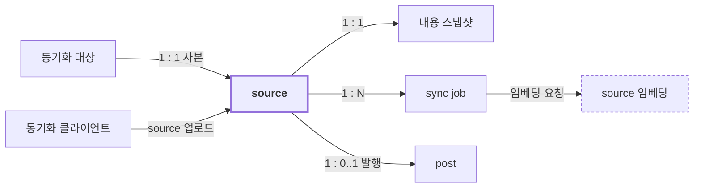
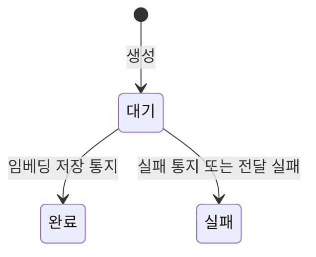

# Library 도메인

## 개요

`library`는 어떤 vault 파일을 source로 받아 두고, 그 source를 post로 어떻게 보여 주는지 정한다.
source 동기화, sync job, post 발행과 검색, 본문 문법을 다룬다.
청크를 나누고 임베딩을 만드는 일은 `ingestion`이 정한다.

## 개념 구조

- vault가 원본이고 source는 동기화 대상 하나의 사본이다. 동기화 대상은 소유자가 frontmatter로 고른다.
- 동기화 클라이언트는 동기화 대상을 자동으로 보낸다. 소유자가 `sheska: false`로 바꾼 파일의 source만 지운다.
- source는 받은 파일 내용을 내용 스냅샷으로 갖는다.
- post는 source와 따로 있는 문서가 아니라 발행한 source다.
- source 업로드로 본문이 바뀌면 sync job을 만들어 `ingestion`에 임베딩을 요청한다.

## 생애

sync job의 상태다. 상태 전이는 제한하지 않는다(`library.syncJob-2`).

- 처리 중은 저장하는 상태가 아니다. 대기 중인 sync job의 임베딩 진행 상황을 보고 조회할 때 판단한다.

## Source 규칙 (source)

어떤 vault 파일이 source가 되고, source가 무엇으로 식별되고 언제 지워지는지 정한다.

| ID | 규칙 |
|---|---|
| [library.source-1](#librarysource-1-원본은-vault) | source 내용은 동기화로만 바꿀 수 있다. |
| [library.source-2](#librarysource-2-경로-하나에-source-하나) | `externalSourceId` 하나에 source는 둘 이상일 수 없다. |
| [library.source-3](#librarysource-3-source-제목) | source 제목은 frontmatter `title`이 비어 있지 않은 문자열이면 그 값이어야 하고, 아니면 `externalSourceId`여야 한다. |
| [library.source-4](#librarysource-4-틀린-frontmatter) | frontmatter 형식이 틀린 파일은 source로 받을 수 없다. |
| [library.source-5](#librarysource-5-obsidian이-만드는-frontmatter) | 파일 맨 앞의 BOM, `---` 뒤의 공백, 빈 frontmatter는 정상 frontmatter로 읽어야 한다. |
| [library.source-6](#librarysource-6-동기화-대상) | vault 파일은 frontmatter `sheska`가 YAML boolean `true`일 때만 동기화 대상이 될 수 있다. |
| [library.source-7](#librarysource-7-source를-지우는-조건) | source는 그 vault 파일의 frontmatter `sheska`가 YAML boolean `false`일 때만 지울 수 있고, 그때는 지워야 한다. |
| [library.source-8](#librarysource-8-source와-함께-지우는-것) | source를 지우면 그 source의 sync job과 post도 함께 지워야 한다. |

### library.source-1 원본은 vault

source 내용은 동기화로만 바꿀 수 있다.
- 예: 관리 화면에서 source 제목이나 본문을 고칠 수 없다.
- 이유: 두 곳에서 편집하면 어느 쪽이 맞는지 정할 수 없고, 다음 동기화가 시스템 안의 편집을 덮어쓴다.

### library.source-2 경로 하나에 source 하나

`externalSourceId` 하나에 source는 둘 이상일 수 없다.
- 예: 같은 경로로 다시 받은 파일은 같은 source를 갱신한다.
- 이유: source 식별자가 유지되므로 post의 URL이 바뀌지 않는다.

### library.source-3 source 제목

source 제목은 frontmatter `title`이 비어 있지 않은 문자열이면 그 값이어야 하고, 아니면 `externalSourceId`여야 한다.
- 예: `title: 회고`이면 `회고`다. `title: ""`, `title: 3`, `title`이 없는 경우는 `externalSourceId`다.
- 이유: vault의 노트는 frontmatter `title` 없이 파일 이름을 제목으로 쓰는 경우가 많다.

### library.source-4 틀린 frontmatter

frontmatter 형식이 틀린 파일은 source로 받을 수 없다.
- 예: 닫는 구분선이 없는 경우, YAML 문법이 틀린 경우, 최상위가 mapping이 아닌 경우
- 이유: 틀린 frontmatter를 본문으로 흘려보내면 작성자가 오류를 모른 채 깨진 문서가 발행된다.
- 참고: 받지 않은 파일은 작성자의 입력 오류로 돌려준다.

### library.source-5 Obsidian이 만드는 frontmatter

파일 맨 앞의 BOM, `---` 뒤의 공백, 빈 frontmatter는 정상 frontmatter로 읽어야 한다.
- 이유: 작성자가 고칠 수 없는 편집기 차이를 입력 오류로 만들지 않는다.

### library.source-6 동기화 대상

vault 파일은 frontmatter `sheska`가 YAML boolean `true`일 때만 동기화 대상이 될 수 있다.
- 예: `sheska: true`는 동기화 대상이다. `sheska: "true"`, `sheska: yes`, `sheska: 1`, `sheska`가 없는 경우는 아니다.
- 이유: source는 모두 검색과 RAG에 쓰인다. 값이 애매한 파일은 올라가지 않아야 소유자가 의도하지 않은 노트가 쓰이지 않는다.
- 이유: source가 되는 길이 frontmatter 하나여야 어떤 노트가 쓰이는지 vault만 보고 알 수 있다.
- 참고: 동기화 대상이 아닌 파일의 source 업로드는 작성자의 입력 오류로 돌려준다.

### library.source-7 source를 지우는 조건

source는 그 vault 파일의 frontmatter `sheska`가 YAML boolean `false`일 때만 지울 수 있고, 그때는 지워야 한다.
- 예: `sheska`를 지우거나, 파일을 지우거나 옮기거나, frontmatter를 읽을 수 없게 되어도 source는 지우지 않는다.
- 이유: 소유자가 명시적으로 뺀 노트만 지운다. 실수일 수 있는 변화로 post와 조회수를 잃게 하지 않는다.
- 참고: `sheska: false`로 바꾸지 않고 파일을 옮기면 새 경로의 source가 생기고 옛 경로의 source는 남는다.

### library.source-8 source와 함께 지우는 것

source를 지우면 그 source의 sync job과 post도 함께 지워야 한다.
- 참고: source 임베딩은 `ingestion.sourceEmbedding-6`이 지운다.

## 동기화 규칙 (sync)

vault 파일을 언제 보내고, source 업로드를 받으면 무엇을 저장하고 임베딩을 다시 만드는지 정한다.

| ID | 규칙 |
|---|---|
| [library.sync-1](#librarysync-1-push-방식) | source는 동기화 클라이언트의 요청으로만 만들고, 바꾸고, 지울 수 있다. |
| [library.sync-2](#librarysync-2-같은-업로드의-반복) | 같은 source 업로드를 여러 번 받은 결과는 한 번 받은 결과와 같아야 한다. |
| [library.sync-3](#librarysync-3-애매하면-보내기) | 동기화 클라이언트는 보낼지 판단이 애매한 파일을 보내야 한다. |
| [library.sync-10](#librarysync-10-자동-동기화) | 동기화 클라이언트는 소유자가 자동 동기화를 끄지 않았으면 동기화 대상을 모두 자동으로 보내야 한다. |
| [library.sync-5](#librarysync-5-source-갱신) | source는 source 업로드의 파일 내용이 저장된 것과 다르면 갱신해야 한다. |
| [library.sync-6](#librarysync-6-임베딩을-다시-만드는-기준) | 임베딩을 다시 만들지는 fingerprint로만 정해야 한다. |
| [library.sync-7](#librarysync-7-sync-job을-만드는-경우) | source 업로드를 받으면 가장 최근 sync job이 현재 fingerprint에 대한 대기나 완료가 아닐 때만 새 sync job을 만들어야 한다. |
| [library.sync-8](#librarysync-8-업로드-응답의-sync-job) | source 업로드 응답은 그 업로드 때문에 기다려야 할 임베딩이 있을 때만 sync job을 담을 수 있다. |
| [library.sync-9](#librarysync-9-동기화-재시도) | 동기화 클라이언트는 실패한 동기화를 횟수 제한 없이 재시도해야 한다. |

### library.sync-1 push 방식

source는 동기화 클라이언트의 요청으로만 만들고, 바꾸고, 지울 수 있다.
- 예: 서버는 vault를 직접 읽지 않는다.

### library.sync-2 같은 업로드의 반복

같은 source 업로드를 여러 번 받은 결과는 한 번 받은 결과와 같아야 한다.
- 이유: 동기화의 정확성은 받는 쪽이 책임진다. 동기화 클라이언트가 전송을 건너뛰는 판단은 비용을 줄이는 최적화다.

### library.sync-3 애매하면 보내기

동기화 클라이언트는 보낼지 판단이 애매한 파일을 보내야 한다.
- 이유: 불필요한 전송의 비용은 대역폭뿐이고, 빠뜨린 전송은 사본이 낡는 오류다.

### library.sync-10 자동 동기화

동기화 클라이언트는 소유자가 자동 동기화를 끄지 않았으면 동기화 대상을 모두 자동으로 보내야 한다.
- 예: 소유자가 자동 동기화를 끄면 다시 켤 때까지 아무 파일도 자동으로 보내지 않는다. 켜면 그사이 바뀐 동기화 대상을 모두 보낸다.
- 이유: 자동 동기화를 끄는 것은 무엇을 보낼지가 아니라 언제 보낼지를 정한다. 동기화 대상은 여전히 frontmatter로만 정해진다(`library.source-6`).

### library.sync-5 source 갱신

source는 source 업로드의 파일 내용이 저장된 것과 다르면 갱신해야 한다.
- 예: frontmatter만 바뀌어도 source는 갱신한다.
- 참고: 임베딩을 다시 만들지는 `library.sync-6`이 따로 정한다.

### library.sync-6 임베딩을 다시 만드는 기준

임베딩을 다시 만들지는 fingerprint로만 정해야 한다.
- 예: frontmatter만 바뀌면 source 제목이 바뀌더라도 fingerprint가 같으므로 임베딩을 다시 만들지 않는다.
- 이유: 임베딩이 읽지 않는 입력이 바뀔 때마다 임베딩을 다시 만들면 연산만 낭비한다.
- 참고: 임베딩이 읽는 입력이 바뀌면 fingerprint에 넣는 입력도 함께 바꾼다.

### library.sync-7 sync job을 만드는 경우

source 업로드를 받으면 가장 최근 sync job이 현재 fingerprint에 대한 대기나 완료가 아닐 때만 새 sync job을 만들어야 한다.
- 예: 가장 최근 sync job이 없거나, 실패했거나, fingerprint가 다르면 새로 만든다.
- 예: 가장 최근 sync job이 현재 fingerprint에 대한 대기나 완료면 새로 만들지 않고 그 sync job을 쓴다.
- 이유: 대기 중인 sync job을 다시 쓰면 요청이 겹쳐도 같은 내용을 두 번 임베딩하지 않는다.
- 이유: 실패했으면 같은 내용이라도 새로 만든다. 같은 내용을 다시 보내는 것이 실패한 동기화를 재시도하는 방법이다.

### library.sync-8 업로드 응답의 sync job

source 업로드 응답은 그 업로드 때문에 기다려야 할 임베딩이 있을 때만 sync job을 담을 수 있다.
- 예: 임베딩이 필요 없는 업로드는 sync job 없이 응답한다.
- 참고: 동기화 클라이언트는 sync job이 없는 응답을 동기화 완료로 기록한다.

### library.sync-9 동기화 재시도

동기화 클라이언트는 실패한 동기화를 횟수 제한 없이 재시도해야 한다.
- 예: 서버가 거부하는 파일도 고쳐질 때까지 계속 다시 보낸다. 이 비용은 감수한다.
- 이유: 서버에는 실패한 sync job을 다시 돌리는 주체가 없다. 동기화 클라이언트가 유일한 재시도 주체다.
- 이유: 대부분의 실패는 임베딩 timeout이나 일시적인 DB 오류처럼 시간이 지나면 풀린다.

## Sync job 규칙 (syncJob)

sync job이 가질 수 있는 상태와 그 상태를 어떻게 읽는지 정한다.

| ID | 규칙 |
|---|---|
| [library.syncJob-1](#librarysyncjob-1-저장-상태) | sync job의 저장 상태는 대기(`waiting`), 완료(`completed`), 실패(`failed`) 중 하나여야 한다. |
| [library.syncJob-2](#librarysyncjob-2-가장-최근-sync-job) | sync job 상태로 하는 판단은 source의 가장 최근 sync job만 볼 수 있다. |
| [library.syncJob-3](#librarysyncjob-3-전달하지-못한-sync-job) | `ingestion`에 끝내 전달하지 못한 sync job은 실패여야 한다. |

### library.syncJob-1 저장 상태

sync job의 저장 상태는 대기(`waiting`), 완료(`completed`), 실패(`failed`) 중 하나여야 한다.
- 예: 처리 중(`processing`)은 저장하지 않고, 조회할 때 임베딩 진행 상황을 보고 판단한다.
- 이유: 진행 상황을 저장하면 저장하는 순간부터 낡는다.

### library.syncJob-2 가장 최근 sync job

sync job 상태로 하는 판단은 source의 가장 최근 sync job만 볼 수 있다.
- 이유: ingestion 결과가 늦게 도착하거나 순서가 뒤바뀌면 이전 sync job의 상태가 사실과 달라질 수 있다.
  가장 최근 sync job만 보면 상태가 틀어져도 다음 업로드에서 회복되므로 상태 전이를 제한하지 않아도 된다.
- 참고: 이전 sync job의 상태에 기대는 기능을 만들려면 먼저 상태 전이 규칙을 정한다.

### library.syncJob-3 전달하지 못한 sync job

`ingestion`에 끝내 전달하지 못한 sync job은 실패여야 한다.
- 이유: 대기로 남으면 동기화 클라이언트가 결과를 기다리다 포기하고 재시도하지 않는다.

## Post 규칙 (post)

source를 언제 발행할 수 있는지와 post가 무엇을 갖는지 정한다.

| ID | 규칙 |
|---|---|
| [library.post-1](#librarypost-1-source-하나에-post-하나) | source 하나에 post는 둘 이상일 수 없다. |
| [library.post-2](#librarypost-2-post의-식별자) | post의 식별자는 그 source의 식별자와 같아야 한다. |
| [library.post-3](#librarypost-3-post의-내용) | post는 source와 따로 제목과 본문을 가질 수 없다. |
| [library.post-4](#librarypost-4-발행-시점) | source는 동기화나 임베딩이 끝나기 전에도 발행할 수 있다. |
| [library.post-5](#librarypost-5-조회수) | 조회수는 post 상세를 조회할 때마다 1 늘어나야 한다. |
| [library.post-6](#librarypost-6-조회와-수정-시각) | 조회수 증가는 post의 수정 시각을 바꿀 수 없다. |

### library.post-1 source 하나에 post 하나

source 하나에 post는 둘 이상일 수 없다.
- 참고: 이미 발행한 source를 다시 발행하면 충돌로 거부한다.

### library.post-2 post의 식별자

post의 식별자는 그 source의 식별자와 같아야 한다.

### library.post-3 post의 내용

post는 source와 따로 제목과 본문을 가질 수 없다.
- 이유: post는 독립된 문서가 아니라 source의 발행 상태와 조회수다.
- 참고: post는 항상 source의 최신 제목과 본문을 보여 준다.

### library.post-4 발행 시점

source는 동기화나 임베딩이 끝나기 전에도 발행할 수 있다.

### library.post-5 조회수

조회수는 post 상세를 조회할 때마다 1 늘어나야 한다.
- 예: 같은 사람이 두 번 조회해도 2 늘어난다. 조회한 사람을 구분하지 않는다.

### library.post-6 조회와 수정 시각

조회수 증가는 post의 수정 시각을 바꿀 수 없다.
- 이유: 조회수를 수정으로 치면 수정 시각이 마지막 조회 시각이 된다.

## 검색 규칙 (search)

post 검색이 무엇을 찾고 어떤 순서로 무엇을 보여 주는지 정한다.

| ID | 규칙 |
|---|---|
| [library.search-1](#librarysearch-1-검색-대상) | 검색 결과에는 post만 나올 수 있다. |
| [library.search-2](#librarysearch-2-결과-합치기) | 검색 결과는 키워드 검색과 의미 검색의 결과를 합쳐 순위를 매겨야 한다. |
| [library.search-3](#librarysearch-3-의미-검색-실패) | 의미 검색이 실패하면 검색 결과는 키워드 검색 결과만으로 돌려줘야 한다. |
| [library.search-4](#librarysearch-4-의미-검색-적용-여부) | 검색 결과는 의미 검색이 적용됐는지 함께 알려야 한다. |
| [library.search-5](#librarysearch-5-제목-일치-우선) | 제목에 키워드가 일치하는 결과는 본문에만 일치하는 결과보다 앞에 와야 한다. |
| [library.search-6](#librarysearch-6-의미-검색-후보) | 의미 검색 후보는 유사도가 기준값보다 큰 청크 임베딩을 가진 post일 때만 될 수 있다. |
| [library.search-7](#librarysearch-7-결과에-보여-주는-값) | 검색 결과마다 일치 이유와 유사도를 보여 줘야 하고, 순위 점수는 보여 줄 수 없다. |

### library.search-1 검색 대상

검색 결과에는 post만 나올 수 있다.
- 예: 발행하지 않은 source는 검색되지 않는다.

### library.search-2 결과 합치기

검색 결과는 키워드 검색과 의미 검색의 결과를 합쳐 순위를 매겨야 한다.

### library.search-3 의미 검색 실패

의미 검색이 실패하면 검색 결과는 키워드 검색 결과만으로 돌려줘야 한다.
- 예: 질의 임베딩이 timeout으로 끝나지 않은 경우도 실패다.
- 이유: 검색은 응답이 늦는 것보다 의미 검색을 포기하는 편이 사용자 경험에 낫다.

### library.search-4 의미 검색 적용 여부

검색 결과는 의미 검색이 적용됐는지 함께 알려야 한다.

### library.search-5 제목 일치 우선

제목에 키워드가 일치하는 결과는 본문에만 일치하는 결과보다 앞에 와야 한다.

### library.search-6 의미 검색 후보

의미 검색 후보는 유사도가 기준값보다 큰 청크 임베딩을 가진 post일 때만 될 수 있다.
- 이유: 기준이 너무 엄격하면 의미상 관련 있는 결과를 놓친다. 기준값을 바꿀 때 이 trade-off를 다시 확인한다.
- 참고: 기준값은 모델 성능을 보며 조정하는 값이라 API 코드가 정한다.

### library.search-7 결과에 보여 주는 값

검색 결과마다 일치 이유와 유사도를 보여 줘야 하고, 순위 점수는 보여 줄 수 없다.
- 이유: 순위 점수는 질의마다 의미가 달라 서로 비교할 수 없다. 유사도는 질의와 상관없이 같은 의미를 갖는다.

## 본문 문법 규칙 (body)

본문을 어떤 문법으로 읽는지 정한다.

| ID | 규칙 |
|---|---|
| [library.body-1](#librarybody-1-같은-문법) | post와 source의 본문은 같은 Obsidian 문법으로 해석해야 한다. |

### library.body-1 같은 문법

post와 source의 본문은 같은 Obsidian 문법으로 해석해야 한다.
- 이유: 화면마다 해석이 다르면 같은 본문이 화면마다 다르게 보인다.
